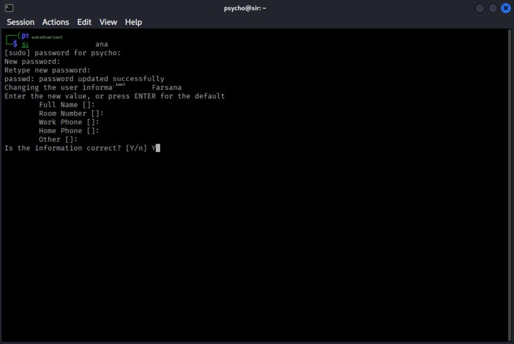
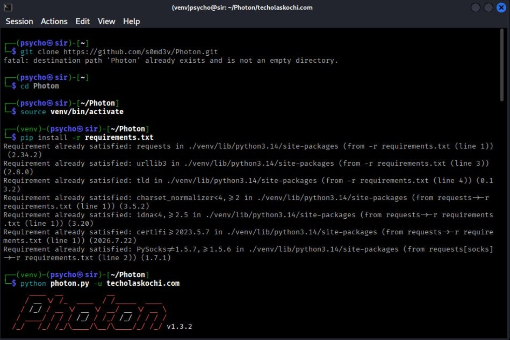
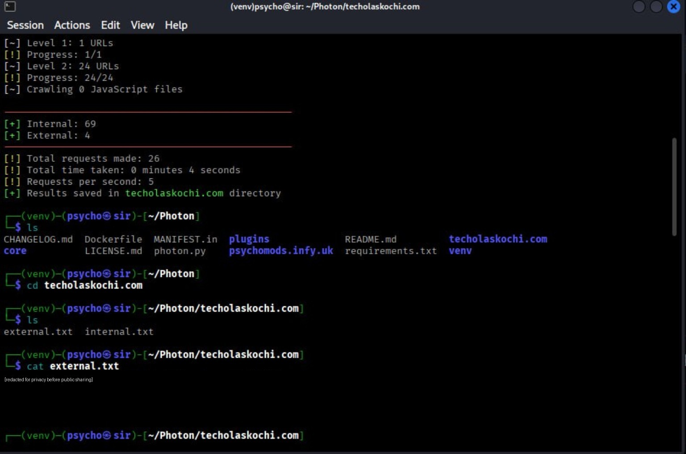

<div align="center">

# ◈ PSYCHOMODS / SECURITY LAB

### PHOTON — OSINT RECONNAISSANCE

**A practical lab journal for website footprinting, crawling, and responsible reconnaissance.**

[](https://github.com/s0md3v/Photon)
[](#overview)
[](#responsible-use)
[](https://github.com/Psychomods666)

[Overview](#overview) · [Lab workflow](#lab-workflow) · [Evidence](#lab-evidence) · [Key findings](#key-findings) · [Ethics](#responsible-use)

---

</div>

## `01` / Overview

**Photon** is an open-source web crawler designed to support reconnaissance and information gathering from a supplied website. In an authorized assessment, crawling can help map links and identify publicly reachable resources that deserve closer manual review.

This repository documents a learning exercise with a Linux terminal and Photon. It records the workflow, selected output, and takeaways—not a claim that the target is vulnerable, compromised, or fully assessed.

> [!NOTE]
> **Scope:** Educational documentation only. Run scans only against systems you own or have explicit permission to assess.

## `02` / Lab snapshot

| Item | Details |
|:--|:--|
| Tool | [Photon](https://github.com/s0md3v/Photon) |
| Category | OSINT · Web crawling · Footprinting |
| Environment shown | Linux terminal |
| Runtime setup | Python virtual environment (`venv`) |
| Dependency source | `requirements.txt` |
| Evidence | Three terminal screenshots |
| Objective | Understand crawl workflow and interpret output responsibly |

## `03` / Lab workflow

### Step 1 — Get the source

Use the official upstream repository and read its current instructions before installing.

```bash
git clone https://github.com/s0md3v/Photon.git
cd Photon
```

If a `Photon` directory already exists, do not clone over it. Inspect the existing folder and confirm that it is the expected repository.

### Step 2 — Create an isolated Python environment

```bash
python3 -m venv venv
source venv/bin/activate
```

A virtual environment keeps project dependencies separate from system-wide Python packages.

### Step 3 — Install dependencies

```bash
python -m pip install --upgrade pip
pip install -r requirements.txt
```

Use a Python version supported by the current project and its dependencies. If an install fails, review the error and the upstream documentation rather than forcing incompatible packages.

### Step 4 — Run against an authorized target

Example command format:

```bash
python photon.py -u example.com
```

Replace `example.com` only with a domain you own or are explicitly authorized to assess. Check the tool's current help and documentation for available options and output behavior.

### Step 5 — Review the generated files

Inspect the generated output directory and its text files. In the documented run, the terminal displayed the summary below.

## `04` / Key findings

<div align="center">

| 26 | 69 | 4 |
|:---:|:---:|:---:|
| **Requests made** | **Internal links** | **External links** |

**Elapsed time:** 4 seconds &nbsp; · &nbsp; **Reported request rate:** 5 requests/second

</div>

These values are from the specific terminal run shown in the screenshots. Results vary with the target, network, configuration, and tool version. “Internal” and “external” counts are crawler output—not a security rating.

## `05` / Lab evidence

The screenshots below document the terminal workflow. The first image is environment/setup context; it is not a Photon feature.

### A — Linux user setup



<sub>Terminal evidence · Local Linux account creation workflow</sub>

### B — Photon environment and execution



<sub>Terminal evidence · Existing project directory, virtual environment, dependencies, and crawl command</sub>

### C — Crawl summary and result review



<sub>Terminal evidence · Crawl summary and review of generated output. Personal profile/contact details should remain redacted in public copies.</sub>

## `06` / Reading the output

| Finding | What it generally means | What to do next |
|:--|:--|:--|
| Internal links | URLs on the same site discovered by the crawler | Check relevant routes manually and within scope |
| External links | Links from the site to other domains | Confirm context; avoid profiling individuals |
| JavaScript resources | Client-side scripts or references found during crawling | Review only where authorized |
| Publicly linked files or routes | Resources reachable or referenced by the site | Confirm exposure and business context before calling anything a finding |

**Important:** a discovered URL is not automatically sensitive, exploitable, or a vulnerability. Validate observations manually, keep notes on evidence and timestamps, and separate facts from assumptions.

## `07` / What this lab taught me

- Setting up and activating a Python virtual environment.
- Installing dependencies from a project's requirements file.
- Running a command-line web crawler against a specified URL.
- Finding and reviewing generated text output.
- Interpreting crawl statistics without overstating their meaning.
- Redacting identifying information before publishing technical evidence.

## `08` / Responsible use

- Test only systems you own or have explicit written authorization to assess.
- Respect legal requirements, site terms, and the agreed assessment scope.
- Use conservative settings; crawling can create load or trigger defensive systems.
- Do not use results to harass, profile, or expose private individuals.
- Never publish credentials, session cookies, API keys, private messages, personal phone numbers, or unredacted target data.
- If a potential secret is discovered, do not use it or attempt access; report it to the owner through an appropriate channel.
- Keep reports factual, minimal, and reproducible.

## `09` / References & links

<div align="center">

[](https://github.com/s0md3v/Photon)
[](https://github.com/s0md3v/Photon/wiki/Usage)
[](https://github.com/Psychomods666)

</div>

---

<div align="center">

**PSYCHOMODS · TECH LAB**

*Learn responsibly. Verify carefully. Document clearly.*

<sub>Personal lab notes · Cybersecurity education · Not an official Photon project</sub>

</div>
